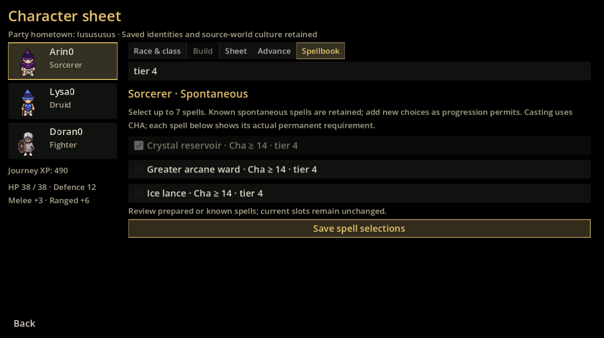
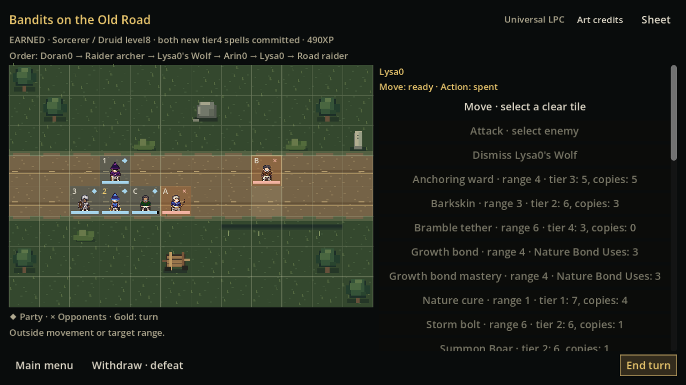

# Genuine Windows Godot evidence

[Native evidence artifact](https://github.com/marksprietsma-beep/road-has-gone-dark/actions/runs/39047311816/artifacts/12107070069) · source `1ac6e6024e46efe30a974cd1b3daeba645294c2c`. All14 frames are actual exported Godot production scenes rendered on Windows. Published PNG bytes and SHA-256 match the native artifact exactly; no image was resized, repainted or regenerated.

Windows window requests labelled1280×720 produced1280×719 content PNGs. Published filenames and the [provenance index](screenshots/screenshots.json) record actual dimensions and original native names. The2560×1440 and640×360 captures are exact. This is an explicitly recorded one-pixel capture-size limitation, not a gameplay failure or a claim of exact720-high output.

The [independent archive audit](evidence/native-archive-audit.json) verifies source/manifest/content, raw native PNG hashes, byte-identical published copies and exact published dimensions. Earned frames use actual490XP/level8 characters and a service-committed battle. Upper-tier records are labelled DEVELOPMENT FIXTURE/not earned XP, retain valid companion ownership and do not overwrite the earned campaign. The capture driver checks original save equality.

|Capture|Scope|
|---|---|
|[earned-sorcerer-tier4-1280x719.png](screenshots/earned-sorcerer-tier4-1280x719.png)|Actual earned490XP/level8|
|[earned-advancement-no-free-xp-1280x719.png](screenshots/earned-advancement-no-free-xp-1280x719.png)|Actual earned490XP/level8|
|[earned-druid-tier4-1280x719.png](screenshots/earned-druid-tier4-1280x719.png)|Actual earned490XP/level8|
|[fixture-sorcerer-tier6-1280x719.png](screenshots/fixture-sorcerer-tier6-1280x719.png)|Development fixture; not earned20|
|[fixture-sorcerer-tier7-1280x719.png](screenshots/fixture-sorcerer-tier7-1280x719.png)|Development fixture; not earned20|
|[fixture-sorcerer-sheet-2560x1440.png](screenshots/fixture-sorcerer-sheet-2560x1440.png)|Development fixture; not earned20|
|[fixture-druid-tier6-1280x719.png](screenshots/fixture-druid-tier6-1280x719.png)|Development fixture; not earned20|
|[fixture-druid-tier7-1280x719.png](screenshots/fixture-druid-tier7-1280x719.png)|Development fixture; not earned20|
|[fixture-druid-sheet-2560x1440.png](screenshots/fixture-druid-sheet-2560x1440.png)|Development fixture; not earned20|
|[fixture-hybrid-independent-tracks-1280x719.png](screenshots/fixture-hybrid-independent-tracks-1280x719.png)|Development fixture; not earned20|
|[fixture-packward-combat-1280x719.png](screenshots/fixture-packward-combat-1280x719.png)|Development fixture; not earned20|
|[fixture-packward-combat-small-640x360.png](screenshots/fixture-packward-combat-small-640x360.png)|Development fixture; not earned20|
|[earned-midbattle-spells-saved-1280x719.png](screenshots/earned-midbattle-spells-saved-1280x719.png)|Actual earned490XP/level8|
|[earned-midbattle-spell-log-2560x1440.png](screenshots/earned-midbattle-spell-log-2560x1440.png)|Actual earned490XP/level8|

