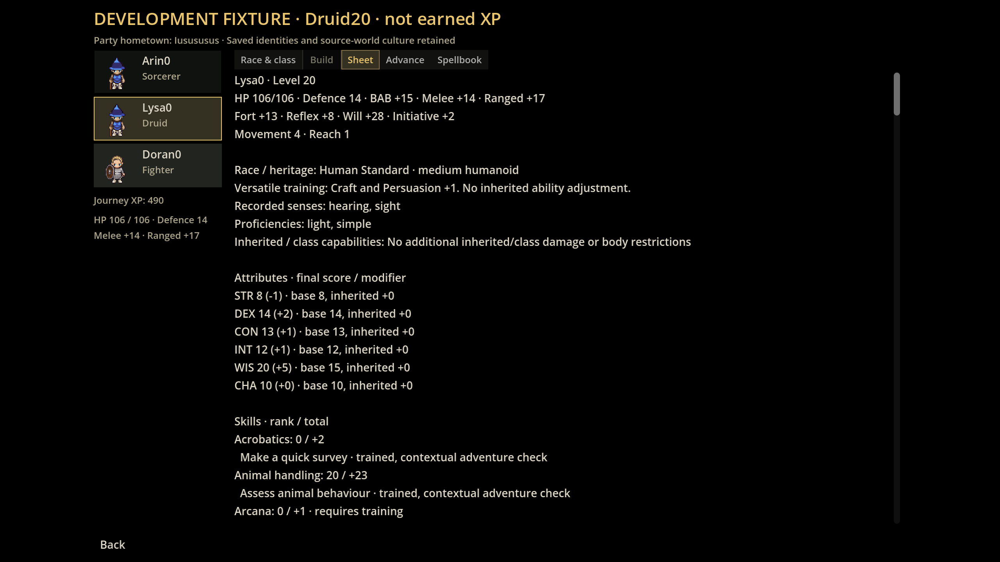
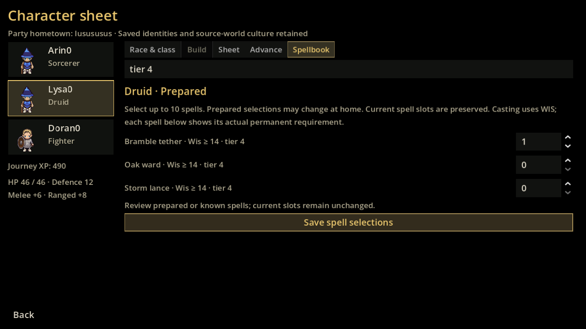
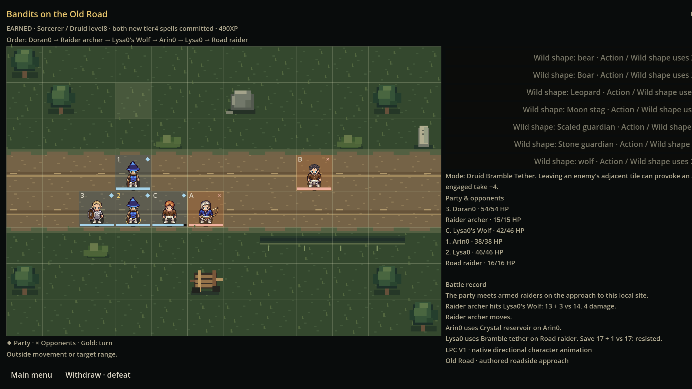

# Actual Windows Godot captures

Source `f9b07179df1709b2ba7fb426bc2c68238a818f7c`, [successful GAME133 workflow](https://github.com/marksprietsma-beep/road-has-gone-dark/actions/runs/39130378223). All14 original PNGs passed their SHA-256 checks. These three representative files are copied byte-for-byte, without editing or resizing. [Provenance, actual dimensions and hashes](evidence/nature-captures.json). The1280×720 requested window actually renders1280×719; the2560×1440 captures are exact.

The sheet is an explicitly labelled level20 development fixture, not an earned level20 character. The original v18 owner/companion remains valid; its read-only render projection now pins both records consistently.

The latter two show the ordinary level8/490XP campaign, including its owned wolf and actual resisted spell result. Existing humanoid companion art fallback and long action-label clipping are unchanged limitations, not repaired artwork or proof of final human acceptance. No replacement identity was manufactured to hide invalid source data.
